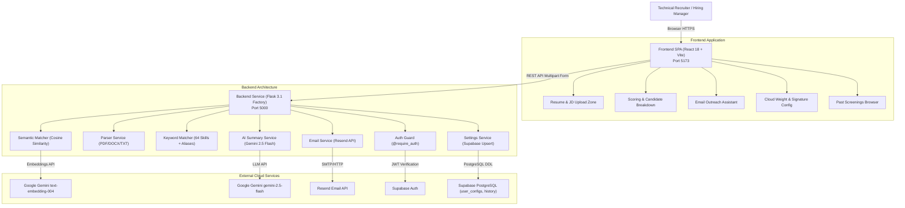

# 🎯 TalentFit AI — Intelligent Resume Screening & Recruitment Platform

TalentFit AI is an automated recruitment platform that matches candidate resumes against job descriptions using a hybrid evaluation engine combining set-based keyword breadth analysis, Google Gemini semantic vector embeddings, seniority detection, generative AI candidate fit summaries, recruitment email automation via Resend, and cloud-synced user preferences via Supabase.

---

## 📖 Table of Contents
1. [Problem Statement & Purpose](#-problem-statement--purpose)
2. [Verified Features](#-verified-features)
3. [Technology Stack](#-technology-stack)
4. [System Architecture](#-system-architecture)
5. [Directory Structure](#-directory-structure)
6. [Prerequisites & Supported Runtimes](#-prerequisites--supported-runtimes)
7. [First-Time Installation & Setup](#-first-time-installation--setup)
8. [Environment Variables & Configuration](#-environment-variables--configuration)
9. [Running with Start.bat](#-running-with-startbat)
10. [Manual Development & Execution Commands](#-manual-development--execution-commands)
11. [Application URLs & API Endpoints](#-application-urls--api-endpoints)
12. [Primary Application Workflows](#-primary-application-workflows)
13. [Database & Model Setup](#-database--model-setup)
14. [Testing & Validation Commands](#-testing--validation-commands)
15. [Troubleshooting](#-troubleshooting)
16. [Known Limitations & Roadmap](#-known-limitations--roadmap)
17. [Security Considerations](#-security-considerations)
18. [Development & Maintenance Guidance](#-development--maintenance-guidance)

---

## 🎯 Problem Statement & Purpose

### The Problem
Traditional Applicant Tracking Systems (ATS) rely primarily on exact string keyword matching. This leads to severe screening failures:
- **Synonym Blindness:** Candidates with `Node.js` or `Postgres` are penalized when a job description asks for `NodeJS` or `PostgreSQL`.
- **Lack of Semantic Context:** A resume stating *"Spearheaded high-throughput event processing pipelines"* may score 0% if the JD specifies *"Kafka message queues"*, even though the underlying experience is directly relevant.
- **Ignored Seniority:** Keyword counting fails to differentiate between junior developers with broad tool exposure and senior architects who lead technical decisions.
- **Manual Overhead:** Recruiters must manually parse resumes, calculate subjective scores, draft individual interview invitations, and track candidate evaluations across disparate tools.

### The Purpose
TalentFit AI solves these challenges through a dual-engine architecture:
- **Set-Based Keyword Engine:** Normalizes technical terminology across 64 canonical target skills and 24 common aliases, calculating true coverage breadth.
- **Gemini Semantic Embeddings:** Uses Google Gemini `models/text-embedding-004` to compare contextual vector embeddings, scaled into calibrated human-interpretable percentage tiers.
- **Seniority Boost:** Detects senior leadership terminology and automatically adds a calibrated score bonus (+5%).
- **Turnkey Outreach:** Generates personalized email invitations and rejection notes via `gemini-2.5-flash` with direct dispatch via Resend.

---

## ✨ Verified Features

### 1. Hybrid AI Scoring Engine
- **Set-Based Keyword Breadth:** Identifies matches against 64 canonical skills with normalization and alias mapping (`nodejs` $\rightarrow$ `node.js`, `postgres` $\rightarrow$ `postgresql`, `golang` $\rightarrow$ `go`, `k8s` $\rightarrow$ `kubernetes`).
- **Guaranteed 60% Minimum Floor:** Automatically grants a 60% keyword floor to candidates possessing 5 or more recognized technical skills.
- **Gemini Semantic Vector Embeddings:** Computes cosine similarity between candidate resume and job description vectors via `models/text-embedding-004`, mapped with piecewise linear scaling:
  - $\ge 0.92 \rightarrow 95\% - 100\%$ (Near-perfect alignment)
  - $0.50 - 0.92 \rightarrow 60\% - 95\%$ (Strong contextual match)
  - $< 0.50 \rightarrow 0\% - 60\%$ (Weak / unrelated)
- **Seniority Boost:** Adds $+5.0\%$ when candidate experience mentions senior leadership titles (`lead`, `senior`, `architect`, `principal`, `staff`, `manager`, `head of`).
- **Heuristic Fallback Mode:** Operates safely when offline or if `GEMINI_API_KEY` is not provided, falling back to clean keyword breadth matching with detailed console logs.
- **Configurable Weights:** Allows recruiters to adjust the balance between keyword breadth and semantic depth (default: 50% keyword / 50% semantic).

### 2. Multi-Format Document Parsing
- **Supported Formats:** In-memory extraction for PDF (`pypdf`), Word Documents (`python-docx`), and plain text (`.txt`).
- **Contact Extraction:** Automatic regex-based parsing to extract candidate email addresses directly from resume text.
- **Dual Job Description Modes:** Recruiters can either paste raw job description text or upload a job description document directly.

### 3. Generative AI Fit Summaries & Outreach
- **2-Sentence Fit Evaluations:** Google `gemini-2.5-flash` provides structured candidate assessments and standardized recommendation ratings (`Strong Match` $\ge 70\%$, `Good Match` $40-69\%$, `Weak Match` $< 40\%$).
- **Recruitment Email Assistant:**
  - 3 pre-built static templates (Interview Invitation, Rejection Notice, Additional Information Request).
  - AI-assisted personalized email drafting.
  - One-click dispatch via Resend API, native `mailto:` links, or Gmail web compose.
  - Automatic recruiter signature injection.

### 4. Cloud Settings Sync & History
- **Supabase Cloud Sync:** Stores customized recruiter weights and email signatures in PostgreSQL table `user_configs`.
- **Screening History:** Persists past screening runs in `history` table with detailed drill-down modal inspection and record deletion.
- **Defensive Unconfigured Fallback:** Includes a safe mock client in [`Frontend/src/supabaseClient.js`](file:///d:/Work/My%20Projects/Talent%20Fit/T-1/TalentFit/Frontend/src/supabaseClient.js) that prevents application crashes when Supabase credentials are not yet supplied.

### 5. Client-Side PDF Export
- Generates professional, multi-page candidate evaluation PDF reports directly in the browser via `html2canvas` and `jspdf`.

---

## 🛠️ Technology Stack

```
                               TalentFit AI
                                    │
           ┌────────────────────────┴────────────────────────┐
           ▼                                                 ▼
      Frontend SPA                                     Backend API
   (React 18 + Vite 5)                              (Flask 3.1 + Python)
  ├── react-router-dom 7.13                        ├── flask-cors 6.0
  ├── tailwindcss 3.4                              ├── scikit-learn 1.9 & numpy 2.5
  ├── framer-motion 11.2                           ├── pypdf 6.2 & python-docx 1.2
  ├── recharts 2.15                                ├── google-generativeai 0.8
  ├── jspdf 4.1 & html2canvas 1.4                  ├── supabase 2.33 & PyJWT 2.15
  └── @supabase/supabase-js 2.95                   └── resend 2.50
```

### Detailed Dependencies
- **Backend Runtime:** Python `3.12.10` (WSGI server: `gunicorn 26.2.0`).
- **Backend Libraries:** `flask 3.1.3`, `flask-cors 6.0.5`, `scikit-learn 1.9.1`, `numpy 2.5.4`, `pypdf 6.21.1`, `python-docx 1.2.0`, `google-generativeai 0.8.6`, `supabase 2.33.0`, `PyJWT 2.15.1`, `resend 2.50.0`, `python-dotenv 1.2.4`, `pytest 9.1.1`.
- **Frontend Runtime:** Node.js `v24.16.0` / npm `12.0.2` (Bundler: `vite 5.4.21`).
- **Frontend Libraries:** `react 18.2.0`, `react-dom 18.2.0`, `react-router-dom 7.13.0`, `framer-motion 11.2.11`, `lucide-react 0.395.0`, `recharts 2.15.4`, `jspdf 4.1.0`, `html2canvas 1.4.1`, `react-markdown 10.1.0`, `axios 1.6.8`, `@supabase/supabase-js 2.95.3`, `clsx 2.1.1`, `tailwind-merge 3.4.0`.

---

## 🏛️ System Architecture



---

## 📂 Directory Structure

```
TalentFit/
├── .env.example                          # Root unified environment configuration template
├── .gitignore                            # Consolidated Git exclusion rules (venv, node_modules, .env)
├── init.md                               # Database DDL schema, RLS policies & service setup manual
├── PROJECT_AUDIT.md                      # Complete 16-section architectural audit and test records
├── README.md                             # Comprehensive project manual & documentation
├── Start.bat                             # One-click Windows development launcher
├── backend/                              # Flask Backend Service
│   ├── .env.example                      # Backend environment template
│   ├── app.py                            # Clean WSGI entry point (compatible with Procfile & CLI)
│   ├── Procfile                          # Render production deployment (web: gunicorn app:app ...)
│   ├── requirements.txt                  # Pinned Python package manifest
│   ├── start.bat                         # Standalone backend Windows launcher
│   ├── app/                              # Modular Flask Application Package
│   │   ├── __init__.py                   # create_app() factory, CORS setup, WSGI app export
│   │   ├── config.py                     # Centralized environment configuration
│   │   ├── extensions.py                 # Singletons for Gemini, Supabase, and Resend
│   │   ├── api/                          # REST API Blueprints
│   │   │   ├── __init__.py               # Blueprint registration helper
│   │   │   ├── analyze.py                # POST /analyze
│   │   │   ├── email.py                  # POST /generate_email & POST /send-email
│   │   │   ├── health.py                 # GET / & GET /test
│   │   │   └── settings.py               # GET & POST /settings
│   │   ├── services/                     # Business Logic Services
│   │   │   ├── __init__.py
│   │   │   ├── ai_summary_service.py     # Gemini 2.5 Flash fit summary & prompt generation
│   │   │   ├── email_service.py          # Resend API email dispatch
│   │   │   ├── keyword_matcher.py        # 64 Skills, aliases & breadth scoring engine
│   │   │   ├── parser_service.py         # Multi-format document parser & email regex
│   │   │   ├── semantic_matcher.py       # Gemini embeddings, scaling math & seniority bonus
│   │   │   └── settings_service.py       # Supabase user_configs query & upsert
│   │   └── utils/                        # Utilities & Decorators
│   │       ├── __init__.py
│   │       ├── auth.py                   # Supabase JWT token verification (@require_auth)
│   │       └── constants.py              # TARGET_SKILLS, SKILL_ALIASES, SENIORITY_TERMS
│   └── tests/                            # Automated Pytest Suite
│       ├── __init__.py
│       ├── conftest.py                   # Pytest fixtures and mock clients
│       ├── test_api.py                   # Route integration tests
│       ├── test_keyword_matcher.py       # Skill presence & breadth scoring tests
│       ├── test_parser.py                # Text extraction & email parsing tests
│       └── test_semantic_matcher.py      # Cosine similarity math & seniority tests
└── Frontend/                             # Vite React SPA
    ├── .env.example                      # Frontend environment template
    ├── .gitignore                        # Frontend exclusion rules (.env, dist, node_modules)
    ├── eslint.config.js                  # ESLint flat configuration
    ├── index.html                        # Vite entry HTML
    ├── package.json                      # Pruned npm package manifest
    ├── package-lock.json                 # Pinned npm dependency lockfile
    ├── postcss.config.cjs                # PostCSS configuration
    ├── tailwind.config.js                # Tailwind CSS design system configuration
    ├── tsconfig.json                     # TypeScript compiler configuration
    ├── tsconfig.node.json                # TypeScript Node compiler configuration
    ├── vercel.json                       # Vercel SPA routing rewrite specification
    ├── vite.config.ts                    # Vite config with '@' alias pointing to './src'
    ├── public/                           # Static assets
    │   ├── favicon.svg                   # Brand favicon
    │   └── google-icon.svg               # Google OAuth brand icon
    └── src/                              # Clean Frontend Source
        ├── App.jsx                       # React Router configuration
        ├── index.css                     # Global design system & Tailwind directives
        ├── main.jsx                      # React 18 DOM mount with AuthProvider
        ├── supabaseClient.js             # Supabase client with graceful unconfigured fallback
        ├── components/                   # Reusable UI Components
        │   ├── HeroSection.jsx           # Resume & JD drag-and-drop upload zone
        │   ├── Navbar.jsx                # Fixed navigation header
        │   ├── ProtectedRoute.jsx        # Auth protection route guard
        │   ├── ScoreChart.jsx            # Recharts candidate score visualization
        │   └── ui/                       # Visual design components
        │       └── shape-landing-hero.tsx# Animated geometric floating shapes
        ├── config/                       # Application configuration
        │   └── api.js                    # Base URL resolution
        ├── context/                      # React contexts
        │   └── AuthContext.jsx           # Supabase auth session, Google OAuth & profile state
        ├── layouts/                      # Layout wrappers
        │   ├── AuthLayout.jsx            # Clean public layout
        │   └── DashboardLayout.jsx       # Authenticated layout with navigation
        ├── lib/                          # Shared utilities
        │   └── utils.js                  # Standard cn() helper (clsx + tailwind-merge)
        ├── pages/                        # View Pages
        │   ├── Dashboard.jsx             # Screening dashboard, candidate cards, PDF download
        │   ├── EmailAssistant.jsx        # Candidate outreach, templates, AI writing, sending
        │   ├── History.jsx               # Past analysis browser, candidate details modal
        │   ├── LandingPage.jsx           # Marketing landing page
        │   ├── Login.jsx                 # User login & registration
        │   └── Settings.jsx              # Cloud settings sync (weights, recruiter signature)
        └── services/                     # Client API Service Layer
            ├── analysisService.js        # Resume analysis & report API calls
            ├── api.js                    # Axios instance with interceptors
            └── settingsService.js        # Settings fetch & sync API calls
```

---

## 💻 Prerequisites & Supported Runtimes

| Requirement | Minimum Supported | Recommended / Verified | Notes |
| :--- | :--- | :--- | :--- |
| **Operating System** | Windows 10 x64, macOS 12+, Ubuntu 20.04+ | Windows 11 x64 | `Start.bat` is built for Windows; manual commands are cross-platform |
| **Python** | `3.10` | `3.12.10` | Requires `python-venv` on Linux systems |
| **Node.js** | `18.0.0` | `v24.16.0` (LTS) | npm `12.0.2` or later |
| **Git** | `2.30+` | `2.45+` | Required for source control |

---

## ⚡ First-Time Installation & Setup

### Step 1: Clone the Repository
```bash
git clone https://github.com/YourUsername/TalentFit.git
cd TalentFit
```

### Step 2: Bootstrap Configuration Files
Copy `.env.example` templates to both the `backend/` and `Frontend/` directories:
```bash
# On Windows CMD
copy backend\.env.example backend\.env
copy Frontend\.env.example Frontend\.env

# On macOS / Linux
cp backend/.env.example backend/.env
cp Frontend/.env.example Frontend/.env
```

### Step 3: Populate API Credentials
Open `backend/.env` and `Frontend/.env` in your editor:
1. **Google Gemini API Key:** Obtain from [Google AI Studio](https://aistudio.google.com/app/apikey). Insert into `backend/.env` under `GEMINI_API_KEY`.
2. **Supabase Credentials:** Create a project at [Supabase Dashboard](https://supabase.com/dashboard).
   - In `backend/.env`: set `SUPABASE_URL` and `SUPABASE_KEY` (service role or anon key).
   - In `Frontend/.env`: set `VITE_SUPABASE_URL` and `VITE_SUPABASE_ANON_KEY`.
3. **Database Schema:** Open the Supabase SQL Editor and execute the schema DDL provided in [`init.md`](file:///d:/Work/My%20Projects/Talent%20Fit/T-1/TalentFit/init.md).
4. **Resend Email API Key (Optional):** Create an API key at [Resend](https://resend.com/api-keys) and set `RESEND_API_KEY` in `backend/.env`.

---

## ⚙️ Environment Variables & Configuration

### Backend (`backend/.env`)
| Variable | Description | Example / Default | Required? |
| :--- | :--- | :--- | :--- |
| `GEMINI_API_KEY` | Google Gemini key for `text-embedding-004` & `gemini-2.5-flash` | `AIzaSy...` | Optional (falls back to keyword-only mode if omitted) |
| `SUPABASE_URL` | Supabase project URL for JWT auth and cloud settings | `https://xyz.supabase.co` | Optional (JWT guard disabled in local mock mode) |
| `SUPABASE_KEY` | Supabase Anon or Service Role key | `eyJhbGciOi...` | Optional |
| `RESEND_API_KEY` | Resend API key for dispatching recruitment emails | `re_123456...` | Optional (mailto/Gmail links remain functional) |
| `PORT` | Flask backend listening port | `5000` | Optional (defaults to 5000) |

### Frontend (`Frontend/.env`)
| Variable | Description | Example / Default | Required? |
| :--- | :--- | :--- | :--- |
| `VITE_SUPABASE_URL` | Client Supabase project endpoint | `https://xyz.supabase.co` | Optional (safe mock client used if missing) |
| `VITE_SUPABASE_ANON_KEY` | Client Supabase public Anon key | `eyJhbGciOi...` | Optional |
| `VITE_API_URL` | Backend Flask service base URL | `http://127.0.0.1:5000` | Optional (defaults to `http://127.0.0.1:5000`) |

---

## 🚀 Running with `Start.bat`

On Windows, launch the entire application with one command:
```cmd
Start.bat
```

### What `Start.bat` Does Automatically:
1. **Prerequisite Check:** Verifies that `python`, `node`, and `npm` are on your system `PATH`.
2. **Virtual Environment Provisioning:** Automatically creates `backend\venv` if it does not already exist.
3. **Idempotent Dependency Installation:** Checks module imports; only runs `pip install` or `npm install` if packages are missing.
4. **Configuration Safety:** Copies `.env.example` templates if `.env` files are missing and inspects for placeholder values without printing secrets.
5. **Duplicate Prevention:** Detects if port `5000` or `5173` is already listening and skips spawning redundant instances.
6. **Ordered Launch & Readiness Polling:**
   - Starts the Flask backend in a dedicated console window (`TalentFit Backend Port 5000`).
   - Actively polls `http://127.0.0.1:5000/` using native `curl.exe` until HTTP 200 is confirmed.
   - Starts the Vite frontend in a dedicated console window (`TalentFit Frontend Port 5173`).
7. **Browser Launch:** Prompts the user to press any key to open `http://localhost:5173` in their default web browser.

---

## 🔧 Manual Development & Execution Commands

### 1. Running the Backend Service
```bash
# Navigate to backend directory
cd backend

# Create virtual environment (first time)
python -m venv venv

# Activate virtual environment
# Windows CMD / PowerShell:
venv\Scripts\activate
# macOS / Linux:
source venv/bin/activate

# Install dependencies
pip install -r requirements.txt

# Run development server
python app.py
```
*The backend API will start at `http://127.0.0.1:5000`.*

### 2. Running the Frontend Development Server
```bash
# Navigate to Frontend directory
cd Frontend

# Install npm dependencies (first time)
npm install

# Start Vite dev server with Hot Module Replacement (HMR)
npm run dev
```
*The frontend SPA will be accessible at `http://localhost:5173`.*

### 3. Building Frontend for Production
```bash
cd Frontend
npm run build
```
*Compiles the optimized production bundle into `Frontend/dist/`.*

---

## 🌐 Application URLs & API Endpoints

### Application URLs
| Application Component | URL | Notes |
| :--- | :--- | :--- |
| **Frontend Web UI** | `http://localhost:5173` | Main interactive recruiter dashboard |
| **Backend API Root** | `http://127.0.0.1:5000/` | Returns JSON service health status |
| **Backend Health Route** | `http://127.0.0.1:5000/test` | Returns `{"message":"Test successful!"}` |

### REST API Endpoints
| HTTP Method | Route | Description | Auth Required? | Payload |
| :--- | :--- | :--- | :--- | :--- |
| `GET` | `/` | Service health status | No | None |
| `GET` | `/test` | Diagnostic connectivity test | No | None |
| `POST` | `/analyze` | Batch candidate resume screening | No | Multipart form: `files`, `jd_file`, `job_description`, `keyword_weight`, `semantic_weight` |
| `POST` | `/generate_email` | AI-generated candidate email draft | No | JSON: `candidate_name`, `job_title`, `missing_skills` |
| `POST` | `/send-email` | Dispatches outreach email via Resend | No | JSON: `to_email`, `subject`, `email_content` |
| `GET` | `/settings` | Retrieves recruiter preferences | **Yes** (`Bearer <token>`) | None |
| `POST` | `/settings` | Persists custom weights & signature | **Yes** (`Bearer <token>`) | JSON: `keyword_weight`, `semantic_weight`, `recruiter_signature` |

---

## 🔄 Primary Application Workflows

### 1. Resume Screening Workflow
1. Navigate to `http://localhost:5173/dashboard`.
2. Drag and drop candidate resumes (PDF, DOCX, or TXT) into the upload zone.
3. Either paste job description text into the text area or upload a job description file.
4. Click **"Analyze Resumes"**.
5. The backend parses each document, normalizes technical skills, queries Gemini for vector embeddings, applies seniority bonuses, calculates composite scores, and returns sorted candidate cards.
6. Click **"Export PDF Report"** to download a formatted multi-page summary.

### 2. Settings Customization Workflow
1. Log in via Supabase authentication.
2. Navigate to `/settings`.
3. Adjust the **Keyword Weight** vs. **Semantic Weight** sliders (e.g., 30% Keyword / 70% Semantic for senior research roles).
4. Update the **Recruiter Signature** text.
5. Click **"Save Settings"**. Preferences are synced to Supabase `user_configs` and dynamically applied to subsequent screening runs.

### 3. Candidate Outreach Workflow
1. On the screening dashboard or history drill-down modal, click **"Email Candidate"**.
2. Select an email template (Interview Invitation, Rejection Notice, Additional Info) or click **"Generate with AI"** to have `gemini-2.5-flash` draft a tailored email referencing specific candidate skills.
3. Choose dispatch method:
   - **Send via Resend:** Direct background dispatch.
   - **Open in Gmail:** Pre-populates a web compose window.
   - **System Mailto:** Opens your local email client (Outlook, Apple Mail).

---

## 🗄️ Database & Model Setup

### 1. Supabase PostgreSQL Schema
The application requires two tables in Supabase with Row Level Security (RLS) enabled. Complete DDL is provided in [`init.md`](file:///d:/Work/My%20Projects/Talent%20Fit/T-1/TalentFit/init.md):

```sql
-- 1. Recruiter Preferences Table
CREATE TABLE public.user_configs (
    id UUID PRIMARY KEY DEFAULT gen_random_uuid(),
    user_id UUID NOT NULL REFERENCES auth.users(id) ON DELETE CASCADE UNIQUE,
    keyword_weight NUMERIC(3, 2) DEFAULT 0.50,
    semantic_weight NUMERIC(3, 2) DEFAULT 0.50,
    recruiter_signature TEXT DEFAULT '',
    created_at TIMESTAMPTZ DEFAULT NOW(),
    updated_at TIMESTAMPTZ DEFAULT NOW()
);

-- 2. Screening History Table
CREATE TABLE public.history (
    id UUID PRIMARY KEY DEFAULT gen_random_uuid(),
    user_id UUID NOT NULL REFERENCES auth.users(id) ON DELETE CASCADE,
    job_title TEXT NOT NULL,
    total_candidates INT NOT NULL,
    created_at TIMESTAMPTZ DEFAULT NOW(),
    results JSONB NOT NULL
);
```

### 2. Google Gemini Models Used
- **`models/text-embedding-004`:** High-dimensional semantic embeddings used for contextual cosine similarity matching between resume text and job specifications.
- **`gemini-2.5-flash`:** Low-latency generative model used for two-sentence candidate fit summaries and personalized recruitment email generation.

---

## 🧪 Testing & Validation Commands

### 1. Automated Backend Test Suite
The repository includes a 16-test suite covering document parsing, regex email extraction, keyword matching, alias normalization, semantic cosine similarity math, seniority boost triggers, and REST API routes:

```bash
cd backend
pytest
```
*Expected Result:*
```text
tests\test_api.py ....                   [ 25%]
tests\test_keyword_matcher.py .....      [ 56%]
tests\test_parser.py ....                [ 81%]
tests\test_semantic_matcher.py ...       [100%]
================ 16 passed, 1 warning in 0.06s ================
```

### 2. WSGI Application Verification
Verify that the Flask application factory compiles and initializes without module shadowing issues:
```bash
cd backend
python -c "from app import app; print('WSGI Status:', app)"
```
*Expected Output:* `WSGI Status: <Flask 'app'>`

### 3. Frontend Production Build Check
Ensure that all TypeScript, JSX, and Tailwind CSS modules bundle cleanly:
```bash
cd Frontend
npm run build
```
*Expected Output:* Exit code 0, 3,300+ modules transformed into `Frontend/dist/`.

---

## ❓ Troubleshooting

### 1. `[WARNING] GEMINI_API_KEY not set. Semantic scoring will fallback.`
- **Cause:** `GEMINI_API_KEY` is missing or contains the default placeholder in `backend/.env`.
- **Solution:** Add a valid API key from [Google AI Studio](https://aistudio.google.com/app/apikey). The platform continues to function in fallback mode using keyword breadth scoring.

### 2. `[WARNING] RESEND_API_KEY not set. Email sending will fail.`
- **Cause:** `RESEND_API_KEY` is not configured in `backend/.env`.
- **Solution:** Provide an API key from [Resend](https://resend.com/api-keys). The "Open in Gmail" and "System Mailto" options remain fully operational as alternatives.

### 3. Resend Free-Tier Sandbox Error (403 Forbidden)
- **Cause:** Resend free-tier sandbox accounts only permit delivering emails to the verified developer email address associated with the account.
- **Solution:** When testing candidate outreach, send to your verified account email or verify a custom sending domain in the Resend dashboard.

### 4. `Port 5000 is already in use` or `Port 5173 is already in use`
- **Cause:** A previous instance of the Flask backend or Vite frontend is still running in the background.
- **Solution:** `Start.bat` automatically detects active ports and skips spawning duplicates. To restart fresh, close the dedicated console windows or terminate processes using:
  ```cmd
  # Find PID on port 5000:
  netstat -ano | findstr :5000
  taskkill /PID <PID> /F
  ```

---

## 🚧 Known Limitations & Roadmap

### Implemented & Verified in Current Release
- [x] Set-based keyword breadth analysis across 64 canonical skills with alias dictionary.
- [x] Google Gemini vector embeddings (`models/text-embedding-004`) with piecewise linear scaling.
- [x] Seniority bonus detection (+5%).
- [x] Multi-format document parser (PDF, DOCX, TXT) and email regex extraction.
- [x] Generative AI 2-sentence fit summary (`gemini-2.5-flash`).
- [x] Recruitment outreach assistant with templates and Resend dispatch.
- [x] Supabase cloud sync for custom weights, recruiter signatures, and screening history.
- [x] One-click Windows development launcher (`Start.bat`) with readiness polling and duplicate protection.

### Known Limitations & Planned Enhancements
- [ ] **Scanned Image OCR:** The current PDF parser processes text-based PDFs. Image-only scanned PDFs require adding an OCR pipeline (e.g. Tesseract or Google Cloud Vision).
- [ ] **Background Task Queue:** Large batch uploads (>50 resumes) run synchronously in HTTP requests. Adding Celery / Redis will allow asynchronous worker queues with progress bars.
- [ ] **Real-Time Webhooks:** Supabase database changes currently poll via standard REST. Real-time Supabase channels are planned for collaborative multi-recruiter environments.
- [ ] **Multi-Tenant Enterprise RBAC:** Team-based organization permissions and role-based access control are planned for a future enterprise release.

---

## 🔒 Security Considerations

- **Secrets Protection:** No API keys or credentials are committed to version control. All `.env` files and `.venv` directories are strictly excluded via root and frontend [`.gitignore`](file:///d:/Work/My%20Projects/Talent%20Fit/T-1/TalentFit/.gitignore).
- **Safe Fallback Initialization:** The frontend Supabase client uses defensive stub initialization to prevent unhandled exceptions or token exposure if environment files are absent.
- **JWT Authentication:** Cloud settings endpoints (`GET & POST /settings`) are protected with the [`@require_auth`](file:///d:/Work/My%20Projects/Talent%20Fit/T-1/TalentFit/backend/app/utils/auth.py) decorator which cryptographically verifies the bearer token against Supabase.
- **Input Sanitization:** Multi-part file uploads validate file extensions (`.pdf`, `.docx`, `.txt`) before passing file streams to document parsers.

---

## 🤝 Development & Maintenance Guidance

### Adding New Canonical Skills
To add technical skills or domain aliases to the keyword engine, edit [`backend/app/utils/constants.py`](file:///d:/Work/My%20Projects/Talent%20Fit/T-1/TalentFit/backend/app/utils/constants.py):
1. Add lowercase canonical skill name to `TARGET_SKILLS`.
2. If the skill is commonly referred to by alternative spellings, add mappings to `SKILL_ALIASES` (e.g., `'k8s': 'kubernetes'`).
3. Run `pytest` in `backend/` to verify tests pass.

### Adjusting Scoring Weights
The scoring formula is defined in [`backend/app/services/semantic_matcher.py`](file:///d:/Work/My%20Projects/Talent%20Fit/T-1/TalentFit/backend/app/services/semantic_matcher.py#L90-L115):
- The default keyword weight ($W_k = 0.50$) and semantic weight ($W_s = 0.50$) can be adjusted in [`backend/app/config.py`](file:///d:/Work/My%20Projects/Talent%20Fit/T-1/TalentFit/backend/app/config.py) or overridden on a per-user basis via Supabase `user_configs`.

---

## 📄 License
This project is licensed under the MIT License — free for personal and commercial usage.
