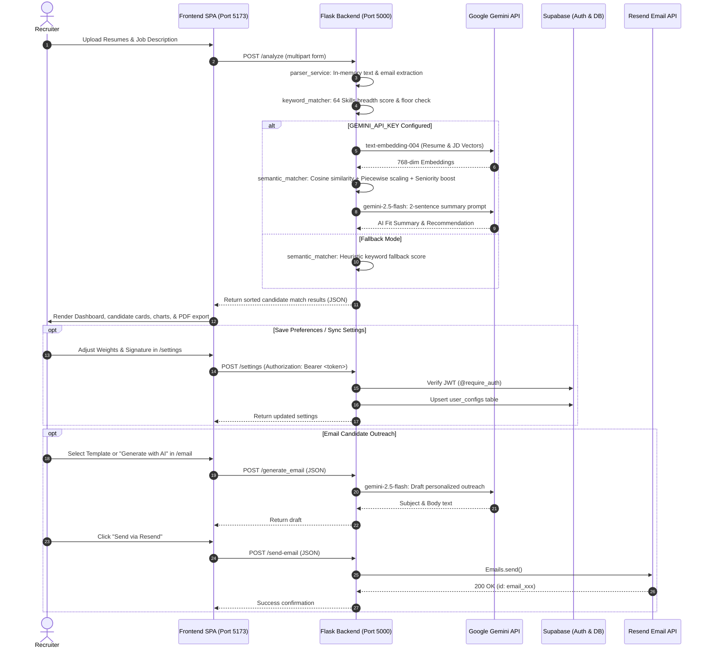

# 🚀 TalentFit AI — Technical Initialization & AI Agent Handoff Guide

> **MANDATORY NOTICE FOR FUTURE AI CODING AGENTS & DEVELOPERS:**  
> **Read this document first.** It serves as the project's compact technical memory. Do not conduct exhaustive, redundant full-repository rescans. Use the [Canonical Directory Map](#3-canonical-directory-map) and [Core Module Map](#8-core-module-map) to navigate directly to the relevant implementation files, verify implementation against active code, preserve [Engineering Invariants](#11-engineering-invariants), and run the [Testing Suite](#12-testing-reference) after any changes.

---

## 1. Project Identity

- **Name:** TalentFit AI
- **Purpose:** Full-stack AI-driven recruitment platform providing automated, multi-resume screening against job specifications using a hybrid scoring engine (set-based keyword breadth analysis + Google Gemini semantic vector embeddings), seniority detection, generative AI candidate fit summaries, recruitment email automation via Resend, and cloud-synced user preferences via Supabase.
- **Current State:** Production-ready, fully modularized architecture. Backend Flask application factory with WSGI entry point, React 18 / Vite 5 SPA frontend, automated Windows launcher (`Start.bat`), and 100% passing automated test suite (16/16 tests passing).
- **Application Entry Points:**
  - **Backend WSGI Entry Point:** [`backend/app.py`](file:///d:/Work/My%20Projects/Talent%20Fit/T-1/TalentFit/backend/app.py) (Exports `app = create_app()`, compatible with Gunicorn `app:app` in `Procfile` and CLI `python app.py`).
  - **Frontend SPA Entry Point:** [`frontend/index.html`](file:///d:/Work/My%20Projects/Talent%20Fit/T-1/TalentFit/frontend/index.html) $\rightarrow$ mounts [`frontend/src/main.jsx`](file:///d:/Work/My%20Projects/Talent%20Fit/T-1/TalentFit/frontend/src/main.jsx).
  - **Master Development Launcher:** [`Start.bat`](file:///d:/Work/My%20Projects/Talent%20Fit/T-1/TalentFit/Start.bat) (One-click Windows developer orchestration).

---

## 2. Technology Stack

| Layer | Technology | Version | Purpose / Responsibilities |
| :--- | :--- | :--- | :--- |
| **Backend Runtime** | Python | `3.12.10` | Core API execution and ML calculations |
| **Backend Framework** | Flask | `3.1.3` | Modular WSGI REST application (`create_app` factory) |
| **CORS Middleware** | Flask-CORS | `6.0.5` | Cross-origin resource sharing for Vite frontend |
| **WSGI Server** | Gunicorn | `26.2.0` | Production Linux WSGI server (Render `Procfile`) |
| **Document Parsers** | pypdf / python-docx | `6.21.1` / `1.2.0` | In-memory text extraction for PDF, DOCX, and TXT |
| **Vector Math & ML** | scikit-learn / numpy | `1.9.1` / `2.5.4` | Cosine similarity matrix operations and vector normalization |
| **AI Embeddings & LLM**| google-generativeai | `0.8.6` | `models/text-embedding-004` (embeddings) & `gemini-2.5-flash` (LLM) |
| **Database & Auth** | Supabase Python / PyJWT | `2.33.0` / `2.15.1` | PostgreSQL persistence and JWT token validation (`@require_auth`) |
| **Email Service** | Resend SDK | `2.50.0` | Transactional email dispatch for candidate outreach |
| **Backend Testing** | pytest | `9.1.1` | Unit, algorithmic, and REST endpoint integration testing |
| **Frontend Runtime** | Node.js / npm | `v24.16.0` / `12.0.2`| Client-side toolchain |
| **Frontend Framework** | React | `18.2.0` | Declarative UI components and state management |
| **Frontend Bundler** | Vite | `5.4.21` | Rapid HMR dev server and optimized Rollup production bundler |
| **Routing** | react-router-dom | `7.13.0` | Client-side routing, protected routes, and layouts |
| **Styling & Design** | Tailwind CSS / PostCSS | `3.4.4` / `8.4.38` | Design system, responsive classes, glassmorphism UI |
| **Animation Engine** | framer-motion | `11.2.11` | Micro-interactions and geometric animated hero background |
| **Data Visualization** | recharts | `2.15.4` | Candidate scoring breakdown bar charts |
| **Client PDF Export** | jsPDF / html2canvas | `4.1.0` / `1.4.1` | Direct in-browser multi-page PDF candidate report generation |
| **Client Auth & DB** | @supabase/supabase-js | `2.95.3` | Client-side OAuth session management and cloud history sync |

---

## 3. Canonical Directory Map

```
TalentFit/
├── Start.bat                             # Master Windows launcher (checks env, venv, ports, launches services)
├── init.md                               # [THIS FILE] Technical initialization & AI agent handoff manual
├── PROJECT_AUDIT.md                      # Complete 17-section repository audit and restructuring history
├── README.md                             # Human-readable user manual and operational documentation
├── .env.example                          # Root unified environment configuration template
├── .gitignore                            # Consolidated Git rules ignoring .env, venv, dist, node_modules
├── backend/                              # Modular Flask Backend Service
│   ├── app.py                            # WSGI entry point (exports app = create_app())
│   ├── Procfile                          # Render deployment spec (web: gunicorn app:app ...)
│   ├── requirements.txt                  # Pinned Python package dependencies (13 packages)
│   ├── start.bat                         # Standalone backend Windows launcher
│   ├── .env.example                      # Backend environment variable template
│   ├── app/                              # Modular Flask application package
│   │   ├── __init__.py                   # create_app() factory, CORS setup, WSGI app export
│   │   ├── config.py                     # Centralized Config class loading os.getenv
│   │   ├── extensions.py                 # Singletons/lazy getters for Gemini, Supabase, Resend
│   │   ├── api/                          # REST API Blueprints
│   │   │   ├── __init__.py               # Blueprint registration helper
│   │   │   ├── analyze.py                # POST /analyze (resume parsing & hybrid scoring)
│   │   │   ├── email.py                  # POST /generate_email & POST /send-email
│   │   │   ├── health.py                 # GET / & GET /test health check routes
│   │   │   └── settings.py               # GET & POST /settings (protected by @require_auth)
│   │   ├── services/                     # Business logic and domain calculations
│   │   │   ├── __init__.py
│   │   │   ├── ai_summary_service.py     # Gemini 2.5 Flash 2-sentence fit summary & email prompts
│   │   │   ├── email_service.py          # Resend API email dispatch
│   │   │   ├── keyword_matcher.py        # 64 Skills, 24 aliases, set breadth scoring engine
│   │   │   ├── parser_service.py         # PDF, DOCX, TXT document parsing & regex email extractor
│   │   │   ├── semantic_matcher.py       # Gemini embeddings, cosine scaling & seniority bonus
│   │   │   └── settings_service.py       # Supabase user_configs database operations
│   │   └── utils/                        # Utilities & cross-cutting concerns
│   │       ├── __init__.py
│   │       ├── auth.py                   # Supabase JWT token verification decorator (@require_auth)
│   │       └── constants.py              # TARGET_SKILLS, SKILL_ALIASES, SENIORITY_TERMS, STOP_WORDS
│   └── tests/                            # Automated Pytest suite (16 tests)
│       ├── __init__.py
│       ├── conftest.py                   # Pytest fixtures and test client setup
│       ├── test_api.py                   # Route status and validation tests
│       ├── test_keyword_matcher.py       # Skill extraction, aliases, and 60% floor tests
│       ├── test_parser.py                # Document parsing and email extraction tests
│       └── test_semantic_matcher.py      # Cosine similarity math, piecewise scaling & seniority tests
└── frontend/                             # Vite React SPA Client
    ├── index.html                        # HTML entry point (references /src/main.jsx)
    ├── package.json                      # Pruned npm package manifest
    ├── package-lock.json                 # Pinned npm dependency lockfile
    ├── vite.config.ts                    # Vite config with '@' alias pointing to './src'
    ├── tailwind.config.js                # Tailwind CSS design system tokens
    ├── vercel.json                       # Vercel SPA routing rewrite config
    ├── .env.example                      # Frontend environment variable template
    ├── .gitignore                        # Frontend Git ignore rules (.env, dist, node_modules)
    └── src/                              # Clean Frontend Source
        ├── main.jsx                      # React 18 DOM mount with AuthProvider
        ├── App.jsx                       # React Router configuration (public, auth, protected)
        ├── index.css                     # Global design tokens and Tailwind base styles
        ├── supabaseClient.js             # Supabase client with graceful unconfigured fallback stub
        ├── components/                   # UI components
        │   ├── HeroSection.jsx           # Drag-and-drop resume & JD upload zone
        │   ├── Navbar.jsx                # Fixed navigation header
        │   ├── ProtectedRoute.jsx        # Route guard checking Supabase auth session
        │   ├── ScoreChart.jsx            # Recharts candidate score visualization
        │   └── ui/
        │       └── shape-landing-hero.tsx# Animated geometric floating shapes (framer-motion)
        ├── config/
        │   └── api.js                    # Base URL resolution (localhost:5000 vs production)
        ├── context/
        │   └── AuthContext.jsx           # Supabase auth session, OAuth provider & profile state
        ├── layouts/
        │   ├── AuthLayout.jsx            # Layout for unauthenticated screens
        │   └── DashboardLayout.jsx       # Layout with Navbar for authenticated views
        ├── lib/
        │   └── utils.js                  # Standard cn() helper combining clsx and tailwind-merge
        ├── pages/                        # View pages
        │   ├── Dashboard.jsx             # Screening dashboard, candidate cards, PDF download
        │   ├── EmailAssistant.jsx        # Candidate outreach, templates, AI writing, sending
        │   ├── History.jsx               # Past analysis browser, candidate details modal
        │   ├── LandingPage.jsx           # Marketing landing page
        │   ├── Login.jsx                 # User login & registration
        │   └── Settings.jsx              # Cloud settings sync (weights, recruiter signature)
        └── services/                     # Client API service layer
            ├── analysisService.js        # Resume analysis & report API calls
            ├── api.js                    # Shared Axios instance with interceptors
            └── settingsService.js        # Settings fetch & sync API calls
```

---

## 4. Architecture and Execution Flow

### System Execution Flow


---

## 5. Initialization Sequence

To stand up a pristine environment from scratch:

1. **Prerequisite Check:** Ensure Python 3.10+ and Node.js 18+ are on the system PATH.
2. **Environment File Bootstrap:**
   ```bash
   copy backend\.env.example backend\.env
   copy Frontend\.env.example Frontend\.env
   ```
3. **Backend Python Setup:**
   ```bash
   cd backend
   python -m venv venv
   venv\Scripts\activate
   pip install -r requirements.txt
   ```
4. **Frontend Node Setup:**
   ```bash
   cd Frontend
   npm install
   ```
5. **Database Initialization:** Run the SQL DDL in [Section 9](#9-api-and-integration-contracts) inside the Supabase SQL Editor.
6. **Launch:** Run [`Start.bat`](file:///d:/Work/My%20Projects/Talent%20Fit/T-1/TalentFit/Start.bat) at the repository root.

---

## 6. Commands Reference

| Operation | Command | Working Directory | Notes / Expected Outcome |
| :--- | :--- | :--- | :--- |
| **Turnkey Startup** | `Start.bat` | `TalentFit/` (Root) | Checks prerequisites, creates venv, checks dependencies, launches backend (:5000) & frontend (:5173) |
| **Run Backend Manually** | `venv\Scripts\activate && python app.py` | `backend/` | Starts Flask development server on `http://127.0.0.1:5000` |
| **Run Frontend Manually** | `npm run dev` | `frontend/` | Starts Vite development server on `http://localhost:5173` |
| **Run Pytest Suite** | `pytest` | `backend/` | Executes all 16 unit and API integration tests (16 passed in ~0.06s) |
| **Verify WSGI Export** | `python -c "from app import app; print(app)"` | `backend/` | Validates WSGI app object loads cleanly without import errors |
| **Build Frontend** | `npm run build` | `frontend/` | Compiles optimized SPA bundle into `frontend/dist/` (Exit code 0) |
| **Backend Health Check**| `curl -s http://127.0.0.1:5000/` | Any | Returns `{"service":"TalentFit Backend","status":"healthy","version":"1.0.0"}` |
| **Kill Port 5000** | `netstat -ano \| findstr :5000` $\rightarrow$ `taskkill /PID <PID> /F` | Any | Terminate orphaned backend process |
| **Kill Port 5173** | `netstat -ano \| findstr :5173` $\rightarrow$ `taskkill /PID <PID> /F` | Any | Terminate orphaned frontend process |

---

## 7. Configuration Contract

| Variable Name | Consuming Service | Location | Required? | Expected Format / Safe Example | Description |
| :--- | :--- | :--- | :--- | :--- | :--- |
| `GEMINI_API_KEY` | Backend (`config.py`) | `backend/.env` | Optional | `AIzaSy...` (Google API Key) | Required for semantic embeddings (`text-embedding-004`) and LLM summaries (`gemini-2.5-flash`). If absent, runs in heuristic fallback. |
| `SUPABASE_URL` | Backend (`config.py`) | `backend/.env` | Optional | `https://xyz.supabase.co` | Supabase project URL for JWT token validation and settings sync. |
| `SUPABASE_KEY` | Backend (`config.py`) | `backend/.env` | Optional | `eyJhbGciOi...` (Anon/Service Role) | Supabase authentication/service key. |
| `RESEND_API_KEY` | Backend (`config.py`) | `backend/.env` | Optional | `re_123456...` | Required for Resend transactional email dispatch. |
| `PORT` | Backend (`app.py`) | `backend/.env` | Optional | `5000` (integer) | Flask listening port (defaults to 5000 if omitted). |
| `VITE_SUPABASE_URL` | Frontend (`supabaseClient.js`) | `frontend/.env` | Optional | `https://xyz.supabase.co` | Supabase client endpoint. If omitted, frontend uses defensive stub. |
| `VITE_SUPABASE_ANON_KEY` | Frontend (`supabaseClient.js`) | `frontend/.env` | Optional | `eyJhbGciOi...` (Anon Public Key) | Public Supabase anon key for client-side authentication. |
| `VITE_API_URL` | Frontend (`api.js`) | `frontend/.env` | Optional | `http://127.0.0.1:5000` | Target URL for backend REST API calls. |

---

## 8. Core Module Map

### Backend Modules (`backend/app/`)
| Module / Symbol | File Path | Responsibilities & Core Functions |
| :--- | :--- | :--- |
| `create_app()` | [`backend/app/__init__.py`](file:///d:/Work/My%20Projects/Talent%20Fit/T-1/TalentFit/backend/app/__init__.py) | Application factory: initializes CORS, registers API blueprints, exports `app = create_app()`. |
| `Config` | [`backend/app/config.py`](file:///d:/Work/My%20Projects/Talent%20Fit/T-1/TalentFit/backend/app/config.py) | Reads and normalizes environment variables from `.env`. |
| `get_gemini_model()` | [`backend/app/extensions.py`](file:///d:/Work/My%20Projects/Talent%20Fit/T-1/TalentFit/backend/app/extensions.py) | Lazy getter returning configured `GenerativeModel('gemini-2.5-flash')` instance or `None`. |
| `get_supabase_client()` | [`backend/app/extensions.py`](file:///d:/Work/My%20Projects/Talent%20Fit/T-1/TalentFit/backend/app/extensions.py) | Lazy getter returning Supabase `Client` or `None`. |
| `require_auth` | [`backend/app/utils/auth.py`](file:///d:/Work/My%20Projects/Talent%20Fit/T-1/TalentFit/backend/app/utils/auth.py) | Route decorator validating `Authorization: Bearer <token>` via Supabase `auth.get_user(token)`. |
| `TARGET_SKILLS` | [`backend/app/utils/constants.py`](file:///d:/Work/My%20Projects/Talent%20Fit/T-1/TalentFit/backend/app/utils/constants.py) | 64 canonical lowercase technical skills. |
| `SKILL_ALIASES` | [`backend/app/utils/constants.py`](file:///d:/Work/My%20Projects/Talent%20Fit/T-1/TalentFit/backend/app/utils/constants.py) | 24 alias mappings (`nodejs` $\rightarrow$ `node.js`, `postgres` $\rightarrow$ `postgresql`, etc.). |
| `SENIORITY_TERMS` | [`backend/app/utils/constants.py`](file:///d:/Work/My%20Projects/Talent%20Fit/T-1/TalentFit/backend/app/utils/constants.py) | Leadership terminology triggering +5% seniority boost. |
| `extract_text()` | [`backend/app/services/parser_service.py`](file:///d:/Work/My%20Projects/Talent%20Fit/T-1/TalentFit/backend/app/services/parser_service.py) | In-memory text extraction for PDF (`pypdf`), DOCX (`python-docx`), and TXT. |
| `parse_email()` | [`backend/app/services/parser_service.py`](file:///d:/Work/My%20Projects/Talent%20Fit/T-1/TalentFit/backend/app/services/parser_service.py) | Regex-based candidate email address extraction. |
| `calculate_keyword_score()`| [`backend/app/services/keyword_matcher.py`](file:///d:/Work/My%20Projects/Talent%20Fit/T-1/TalentFit/backend/app/services/keyword_matcher.py) | Set-based breadth score: $\min(100, \frac{\text{len(found)}}{\max(\text{len(jd)}, 10)} \times 100)$ with $\ge 5$ skills 60% floor. |
| `calculate_semantic_score()`| [`backend/app/services/semantic_matcher.py`](file:///d:/Work/My%20Projects/Talent%20Fit/T-1/TalentFit/backend/app/services/semantic_matcher.py) | Generates `text-embedding-004` vectors, computes cosine similarity, applies piecewise scaling. |
| `get_overall_score()` | [`backend/app/services/semantic_matcher.py`](file:///d:/Work/My%20Projects/Talent%20Fit/T-1/TalentFit/backend/app/services/semantic_matcher.py) | Combines $(W_k \times \text{Key}) + (W_s \times \text{Sem}) + \text{Seniority}$, clamped to $[0.0, 100.0]$. |
| `generate_ai_summary()` | [`backend/app/services/ai_summary_service.py`](file:///d:/Work/My%20Projects/Talent%20Fit/T-1/TalentFit/backend/app/services/ai_summary_service.py) | Calls `gemini-2.5-flash` for 2-sentence summary and recommendation rating. |
| `send_email_service()` | [`backend/app/services/email_service.py`](file:///d:/Work/My%20Projects/Talent%20Fit/T-1/TalentFit/backend/app/services/email_service.py) | Calls `resend.Emails.send()` with structured error handling. |
| `analyze_bp` | [`backend/app/api/analyze.py`](file:///d:/Work/My%20Projects/Talent%20Fit/T-1/TalentFit/backend/app/api/analyze.py) | Handles `POST /analyze` multipart resume batch upload. |

### Frontend Modules (`frontend/src/`)
| Module / Symbol | File Path | Responsibilities & Core Functions |
| :--- | :--- | :--- |
| `supabase` | [`frontend/src/supabaseClient.js`](file:///d:/Work/My%20Projects/Talent%20Fit/T-1/TalentFit/frontend/src/supabaseClient.js) | Exports configured Supabase client or a defensive safe stub if keys are absent. |
| `cn()` | [`frontend/src/lib/utils.js`](file:///d:/Work/My%20Projects/Talent%20Fit/T-1/TalentFit/frontend/src/lib/utils.js) | Tailwind class merging combining `clsx` and `tailwind-merge`. |
| `analysisService` | [`frontend/src/services/analysisService.js`](file:///d:/Work/My%20Projects/Talent%20Fit/T-1/TalentFit/frontend/src/services/analysisService.js) | API methods for `analyzeResumes(formData)` and `fetchSettings()`. |
| `settingsService` | [`frontend/src/services/settingsService.js`](file:///d:/Work/My%20Projects/Talent%20Fit/T-1/TalentFit/frontend/src/services/settingsService.js) | API methods for `getSettings()` and `saveSettings(payload)`. |
| `HeroSection` | [`frontend/src/components/HeroSection.jsx`](file:///d:/Work/My%20Projects/Talent%20Fit/T-1/TalentFit/frontend/src/components/HeroSection.jsx) | Drag-and-drop resume upload zone and job description input. |
| `Dashboard` | [`frontend/src/pages/Dashboard.jsx`](file:///d:/Work/My%20Projects/Talent%20Fit/T-1/TalentFit/frontend/src/pages/Dashboard.jsx) | Results visualizer, score badges, skill chips, AI summaries, and PDF download. |
| `EmailAssistant` | [`frontend/src/pages/EmailAssistant.jsx`](file:///d:/Work/My%20Projects/Talent%20Fit/T-1/TalentFit/frontend/src/pages/EmailAssistant.jsx) | Candidate outreach composer with static templates, AI drafting, and Resend sending. |

---

## 9. API and Integration Contracts

### 1. `POST /analyze`
- **Request Content-Type:** `multipart/form-data`
- **Fields:**
  - `files`: One or more binary files (`.pdf`, `.docx`, `.txt`).
  - `jd_file` (optional): Binary file for job description.
  - `job_description` (optional): Raw text string of job description.
  - `keyword_weight` (optional): Float `0.0 - 1.0` (defaults to 0.50).
  - `semantic_weight` (optional): Float `0.0 - 1.0` (defaults to 0.50).
- **Response Format (JSON):**
  ```json
  {
    "results": [
      {
        "id": 0,
        "filename": "candidate_resume.pdf",
        "score": 86.4,
        "email": "candidate@example.com",
        "found_skills": ["Python", "React", "Docker", "AWS"],
        "missing_skills": ["Kubernetes"],
        "breakdown": {
          "keyword": {
            "score": 80.0,
            "matched_keywords": ["Python", "React", "Docker", "AWS"],
            "missing_keywords": ["Kubernetes"]
          },
          "semantic": {
            "score": 88.5
          }
        },
        "ai_summary": "Strong candidate with solid backend engineering background.\nRecommendation: Strong Match"
      }
    ]
  }
  ```

### 2. `POST /generate_email`
- **Request Content-Type:** `application/json`
- **Payload:** `{"candidate_name": "Jane", "job_title": "Full Stack Engineer", "missing_skills": ["GraphQL"]}`
- **Response (JSON):** `{"subject": "Interview Invitation: Full Stack Engineer", "body": "Hi Jane,\n\n..."}`

### 3. `POST /send-email`
- **Request Content-Type:** `application/json`
- **Payload:** `{"to_email": "candidate@example.com", "subject": "Update", "email_content": "<p>Content</p>"}`
- **Response (JSON):** `{"success": true, "id": "email_xxx", "message": "Email sent successfully"}`

### 4. `GET & POST /settings`
- **Header:** `Authorization: Bearer <supabase_jwt_token>`
- **Payload (`POST`):** `{"keyword_weight": 0.40, "semantic_weight": 0.60, "recruiter_signature": "Jane Doe\nLead Recruiter"}`
- **Response (`GET` & `POST`):**
  ```json
  {
    "keyword_weight": 0.40,
    "semantic_weight": 0.60,
    "recruiter_signature": "Jane Doe\nLead Recruiter"
  }
  ```

### 5. Supabase PostgreSQL Schema DDL
```sql
-- Recruiter Configurations Table
CREATE TABLE IF NOT EXISTS public.user_configs (
    user_id UUID PRIMARY KEY REFERENCES auth.users(id) ON DELETE CASCADE,
    keyword_weight NUMERIC DEFAULT 0.50 CHECK (keyword_weight >= 0 AND keyword_weight <= 1),
    semantic_weight NUMERIC DEFAULT 0.50 CHECK (semantic_weight >= 0 AND semantic_weight <= 1),
    signature_name TEXT DEFAULT '',
    signature_role TEXT DEFAULT '',
    signature_company TEXT DEFAULT '',
    updated_at TIMESTAMPTZ DEFAULT NOW()
);
ALTER TABLE public.user_configs ENABLE ROW LEVEL SECURITY;
CREATE POLICY "Users view own configs" ON public.user_configs FOR SELECT USING (auth.uid() = user_id);
CREATE POLICY "Users insert own configs" ON public.user_configs FOR INSERT WITH CHECK (auth.uid() = user_id);
CREATE POLICY "Users update own configs" ON public.user_configs FOR UPDATE USING (auth.uid() = user_id);

-- Screening History Table
CREATE TABLE IF NOT EXISTS public.history (
    id BIGINT GENERATED BY DEFAULT AS IDENTITY PRIMARY KEY,
    user_id UUID REFERENCES auth.users(id) ON DELETE CASCADE,
    job_title TEXT NOT NULL,
    candidate_count INTEGER NOT NULL DEFAULT 1,
    top_match_score NUMERIC NOT NULL DEFAULT 0.0,
    results JSONB NOT NULL,
    created_at TIMESTAMPTZ DEFAULT NOW()
);
ALTER TABLE public.history ENABLE ROW LEVEL SECURITY;
CREATE POLICY "Users view own history" ON public.history FOR SELECT USING (auth.uid() = user_id);
CREATE POLICY "Users insert own history" ON public.history FOR INSERT WITH CHECK (auth.uid() = user_id);
CREATE POLICY "Users delete own history" ON public.history FOR DELETE USING (auth.uid() = user_id);
CREATE INDEX IF NOT EXISTS idx_history_user_id ON public.history(user_id, created_at DESC);
```

---

## 10. Dependency Constraints

1. **WSGI Module Precedence:** `backend/app.py` resides next to package directory `backend/app/`. Do not rename or eliminate `app = create_app()` inside [`backend/app/__init__.py`](file:///d:/Work/My%20Projects/Talent%20Fit/T-1/TalentFit/backend/app/__init__.py). Python imports `app/__init__.py` first when resolving `gunicorn app:app`.
2. **Google Generative AI SDK:** Pinned to `google-generativeai>=0.8.0`. Do not upgrade to `google.genai` without rewriting the `genai.embed_content()` and `GenerativeModel` calls.
3. **MUI Dependencies:** `@mui/material`, `@emotion/react`, and `@emotion/styled` were deliberately pruned in Phase 3. Do not re-add them. All UI styling is implemented via Tailwind CSS.
4. **Vite Alias:** The `@` path alias in [`frontend/vite.config.ts`](file:///d:/Work/My%20Projects/Talent%20Fit/T-1/TalentFit/frontend/vite.config.ts) resolves to `./src`. Relative imports to `@/lib/utils` depend on [`frontend/src/lib/utils.js`](file:///d:/Work/My%20Projects/Talent%20Fit/T-1/TalentFit/frontend/src/lib/utils.js).

---

## 11. Engineering Invariants

The following domain rules and formulas are mathematically invariant and must never be altered without explicit architectural approval:

1. **Composite Scoring Formula:**
   $$\text{Final Score} = \min\left(100.0, (W_k \times \text{Keyword}) + (W_s \times \text{Semantic}) + \text{Seniority Bonus}\right)$$
2. **Keyword Breadth Scoring:**
   $$\text{Keyword Score} = \min\left(100.0, \frac{\text{len(all\_found)}}{\max(\text{len(jd\_required)}, 10)} \times 100\right)$$
   *Constraint:* If candidate possesses $\ge 5$ recognized skills from `TARGET_SKILLS`, the score is floored at a minimum of $60.0\%$.
3. **Piecewise Semantic Scaling:**
   $$\text{Semantic Score} = \begin{cases} 
   95.0 + \frac{\text{cos} - 0.92}{0.08} \times 5.0 & \text{if } \text{cos} \ge 0.92 \\
   60.0 + \frac{\text{cos} - 0.50}{0.42} \times 35.0 & \text{if } 0.50 \le \text{cos} < 0.92 \\
   \max(0.0, \frac{\text{cos}}{0.50} \times 60.0) & \text{if } \text{cos} < 0.50 
   \end{cases}$$
4. **Seniority Boost:** Exactly $+5.0\%$ added if resume contains any word from `SENIORITY_TERMS`.
5. **No Fatal Crashes on Missing `.env`:**
   - Frontend must mount gracefully with console warnings and mock stubs.
   - Backend must start and fall back to keyword heuristic matching without crashing.
6. **Procfile Compatibility:** [`backend/Procfile`](file:///d:/Work/My%20Projects/Talent%20Fit/T-1/TalentFit/backend/Procfile) command `web: gunicorn app:app --bind 0.0.0.0:$PORT` must remain strictly valid for Render deployment.

---

## 12. Testing Reference

- **Test Suite Location:** [`backend/tests/`](file:///d:/Work/My%20Projects/Talent%20Fit/T-1/TalentFit/backend/tests/)
- **Command:** `cd backend && pytest`
- **Current Verified Status:** **16 passed, 0 failed** in 0.06s.
- **Coverage Summary:**
  - `test_parser.py` (4 tests): Text extraction for `.txt`, empty files, email regex found/not found.
  - `test_keyword_matcher.py` (5 tests): Skill aliases normalization, presence checking, 60% floor threshold, stop-words filtering.
  - `test_semantic_matcher.py` (3 tests): Cosine math, piecewise bounds, seniority boost (+5%), composite formula.
  - `test_api.py` (4 tests): `GET /`, `GET /test`, `POST /analyze` 400 validation, `GET /settings` 401 guard.
- **Untested Statically:** Live remote API calls (Google Gemini live network requests, Supabase remote OAuth flow, live Resend SMTP delivery) are mocked in tests and require valid user keys for end-to-end network verification.

---

## 13. Known Issues & Operational Notes

1. **Resend Free-Tier Sandbox Delivery:** In sandbox mode, Resend restricts outbound email recipients to the verified developer email address. Candidate outreach to arbitrary email addresses will fail with a 403 error until a domain is verified. Use the built-in "Open in Gmail" or "System Mailto" buttons as fallback options.
2. **Synchronous File Uploads:** Uploading large batches (>50 resumes) is currently processed synchronously in a single HTTP request. An asynchronous Celery/Redis queue is recommended for enterprise volume.
3. **Text-Only PDF Parsing:** `pypdf` extracts text streams. Scanned image-based PDFs without OCR text layers yield empty extracted strings.

---

## 14. Instructions for Future AI Agents

1. **Read `init.md` First:** Before making any modifications, read this document to understand architectural boundaries, file locations, and constraints.
2. **Do Not Rescan the Repository:** Do not run recursive grep searches across the entire workspace to discover basic architecture. Use the [Canonical Directory Map](#3-canonical-directory-map) and [Core Module Map](#8-core-module-map) directly.
3. **Inspect Relevant Code Before Editing:** Verify implementation details in the specific module file before altering code.
4. **Preserve Invariants:** Do not alter the scoring formulas, Procfile commands, or WSGI app export conventions.
5. **Execute Validation:** After modifying backend code, run `pytest` in `backend/`. After modifying frontend code, run `npm run build` in `frontend/`.
6. **Update Documentation:** If you add endpoints, modify configurations, or alter schemas, update `init.md`, `README.md`, and `PROJECT_AUDIT.md`.

---

## 15. Sources of Truth

| Entity | Canonical Source of Truth File |
| :--- | :--- |
| **Backend Dependencies** | [`backend/requirements.txt`](file:///d:/Work/My%20Projects/Talent%20Fit/T-1/TalentFit/backend/requirements.txt) |
| **Frontend Dependencies** | [`frontend/package.json`](file:///d:/Work/My%20Projects/Talent%20Fit/T-1/TalentFit/frontend/package.json) |
| **Environment Variables** | [`.env.example`](file:///d:/Work/My%20Projects/Talent%20Fit/T-1/TalentFit/.env.example) |
| **Database Schema & RLS** | [`init.md` (Section 9)](#9-api-and-integration-contracts) |
| **Canonical Skills & Aliases** | [`backend/app/utils/constants.py`](file:///d:/Work/My%20Projects/Talent%20Fit/T-1/TalentFit/backend/app/utils/constants.py) |
| **WSGI Deployment Spec** | [`backend/Procfile`](file:///d:/Work/My%20Projects/Talent%20Fit/T-1/TalentFit/backend/Procfile) & [`backend/app.py`](file:///d:/Work/My%20Projects/Talent%20Fit/T-1/TalentFit/backend/app.py) |
| **Local Windows Launcher** | [`Start.bat`](file:///d:/Work/My%20Projects/Talent%20Fit/T-1/TalentFit/Start.bat) |
